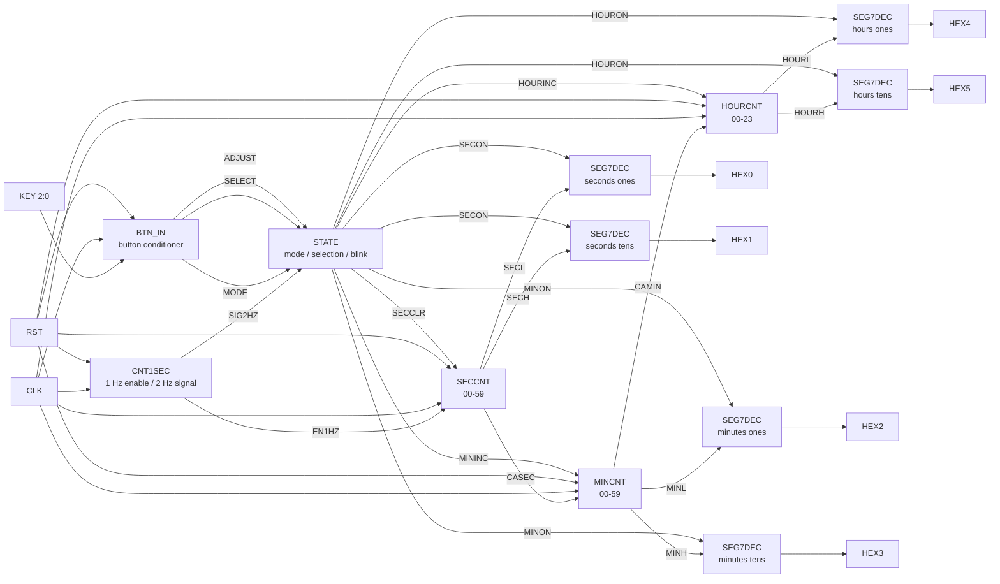
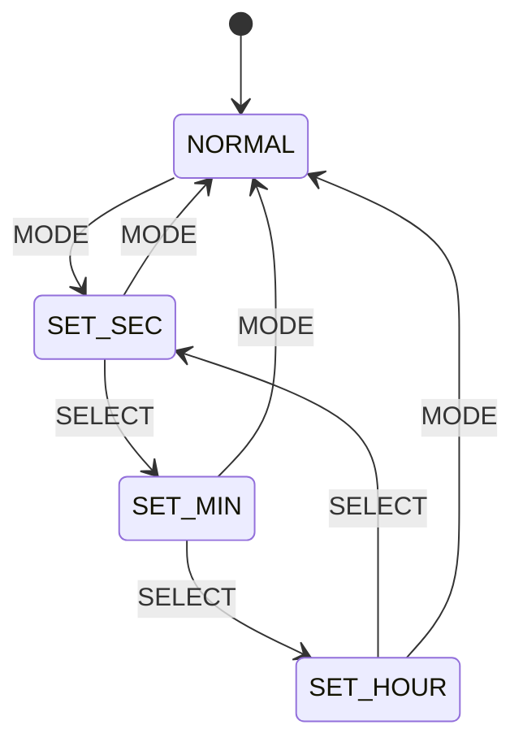

# LSI開発研修ハンズオン設計

## 24時間計の実装を通じたVerilog HDL・FPGA・テストベンチ実習

## 0. このハンズオンの位置づけ

本ハンズオンでは、これまで書籍で学習してきた **Verilog HDLの基本文法**、**Quartus Primeを用いた設計フロー**、**FPGAボードへの書き込み**、**ロジックアナライザによる信号観測**を、24時間計の実装を通して復習します。

学習を次の2段階に分けます。

1. **基本文法の復習**  
   24時間計を構成する各RTLモジュールを0から実装し、シミュレーション前の設計力とFPGA実装力を身につけます。
2. **テストベンチ設計の実習**  
   第1段階で作成したモジュールを検証対象（DUT）として再利用し、単体検証から結合検証へ進みます。

両段階の共通ゴールは、次のとおりです。

> 「時・分・秒の計数、時刻合わせ、表示制御を備えた24時間計を、自分で設計し、自分で正しさを確認できるようになる」

---

## 1. 完成時の機能仕様

### 1.1 基本機能

- 秒を `00` から `59` まで計数する。
- 秒が `59` から `00` に戻るとき、分を1増加する。
- 分を `00` から `59` まで計数する。
- 分が `59` から `00` に戻るとき、時を1増加する。
- 時を `00` から `23` まで計数する。
- `23:59:59` の次を `00:00:00` とする。
- 6桁の7セグメントLEDに `HH:MM:SS` を表示する。
- ボタン入力により、通常表示と時刻合わせモードを切り替える。
- 時刻合わせ中は、選択した桁を点滅させる。
- 分または時をボタン操作で1ずつ進められる。
- 秒をクリアできる。

### 1.2 想定するボタン

| 入力 | 役割 |
|---|---|
| `MODE` | 通常モードと時刻合わせモードの切り替え |
| `SELECT` | 秒・分・時の選択対象を切り替える |
| `ADJUST` | 選択対象をクリアまたは1増加する |

ボタンが負論理の場合、FPGAボード上の入力名を `nBIN` とし、`btn_in.v` 内部で押下パルスへ変換します。

### 1.3 リセット方針

本実習では、最初に次のいずれかを設計仕様として明記します。

- **同期リセット**: `always @(posedge CLK)` の中で `if (RST)` を判定する。
- **非同期リセット**: `always @(posedge CLK or posedge RST)` と記述する。

学習初期は設計全体を同期リセットに統一すると、タイミングを追いやすくなります。教材の既存仕様に合わせる場合は、その仕様を優先します。重要なのは、モジュールごとに方式を混在させず、意図を説明できることです。

---

## 2. 開発対象のディレクトリ構成

```text
CLOCK24/
├── HDL/
│   ├── btn_in.v
│   ├── clock24.v
│   ├── cnt1sec.v
│   ├── hourcnt.v
│   ├── mincnt.v
│   ├── seccnt.v
│   ├── seg7dec.v
│   └── state.v
├── TB/
│   ├── tb_btn_in.v
│   ├── tb_cnt1sec.v
│   ├── tb_hourcnt.v
│   ├── tb_mincnt.v
│   ├── tb_seccnt.v
│   ├── tb_seg7dec.v
│   ├── tb_state.v
│   └── tb_clock24.v
├── constraints/
│   └── clock24.qsf
├── simulation/
├── docs/
│   ├── specification.md
│   ├── block_diagram.md
│   └── test_plan.md
└── README.md
```

第1段階では主に `HDL/` を作成します。第2段階では同じRTLを変更せず、原則として `TB/` 側から検証します。

---

# 第1段階：基本文法の復習

## 3. 第1段階の目的

24時間計を機能単位に分割し、各モジュールをVerilog HDLで実装します。単に完成コードを書き写すのではなく、次の判断ができるようになることを目的とします。

- 組み合わせ回路と順序回路を区別できる。
- `wire` と `reg` の役割を説明できる。
- `assign` と `always` を使い分けられる。
- ブロッキング代入 `=` とノンブロッキング代入 `<=` を使い分けられる。
- カウンタの桁上がり条件を論理式にできる。
- ビット幅を意識して信号を宣言できる。
- 上位モジュールで下位モジュールを接続できる。
- 合成結果から、記述したRTLがどのような回路になったか確認できる。
- FPGA上の実信号をロジックアナライザで観測できる。

## 4. 24時間計の回路図ヒント

以下は、提示されたトップモジュールの接続関係を学習用に整理したブロック図です。各箱の内部回路は示さず、まず「入力」「出力」「接続関係」から各モジュールの役割を推測します。



### 4.1 信号の流れを3系統に分ける

#### A. 時刻を進める系統

```text
CLK → CNT1SEC → EN1HZ → SECCNT → CASEC → MINCNT → CAMIN → HOURCNT
```

- `EN1HZ`: 秒カウンタを1秒ごとに進めるイネーブル信号
- `CASEC`: 秒が59から00へ戻るときの桁上がり信号
- `CAMIN`: 分が59から00へ戻るときの桁上がり信号

#### B. 時刻合わせを制御する系統

```text
KEY → BTN_IN → MODE / SELECT / ADJUST → STATE
                                      ├→ SECCLR
                                      ├→ MININC
                                      └→ HOURINC
```

#### C. 表示する系統

```text
時・分・秒カウンタ → BCD各桁 → SEG7DEC → HEX0～HEX5
STATE → SECON / MINON / HOURON → 表示または消灯
```

## 5. モジュール別の実装課題

### 5.1 `seg7dec.v`：7セグメントデコーダ

**役割**  
4ビットの数値を7セグメントLEDの点灯パターンへ変換します。

**主な復習項目**

- 組み合わせ回路
- `always @(*)`
- `case` 文
- デフォルト値
- 負論理出力
- ラッチを作らない記述

**想定インターフェース**

```verilog
module SEG7DEC(
    input      [3:0] DIN,
    input            EN,
    output reg [6:0] nHEX
);
```

**実装条件**

- `EN == 1'b0` のときは全セグメントを消灯する。
- `DIN` が0～9のとき、対応する数字を表示する。
- 10～15は消灯またはエラー表示とし、仕様を明記する。
- FPGAボードが負論理点灯なら、`0` が点灯、`1` が消灯となる。

**確認課題**

1. `case` の全分岐に代入がないと、なぜラッチが推論される可能性があるか。
2. `nHEX` を `wire` ではなく `reg` とする理由は何か。
3. LEDの点灯論理がボードによって異なる場合、どこを変更すべきか。

---

### 5.2 `seccnt.v`：秒カウンタ

**役割**  
`00`～`59`をBCD 2桁で計数し、59から00へ戻るときに桁上がりを生成します。

**主な復習項目**

- 順序回路
- `always @(posedge CLK)`
- ノンブロッキング代入
- クロックイネーブル
- BCDカウンタ
- 優先順位を持つ条件分岐

**想定インターフェース**

```verilog
module SECCNT(
    input            CLK,
    input            RST,
    input            EN,
    input            CLR,
    output reg [2:0]  QH,
    output reg [3:0]  QL,
    output           CA
);
```

**優先順位の例**

1. `RST`
2. `CLR`
3. `EN`
4. 保持

**動作を先に文章化する**

- `QL < 9` なら、1の位だけを1増やす。
- `QL == 9` かつ `QH < 5` なら、1の位を0にして10の位を1増やす。
- `59` なら、両方を0に戻す。
- `EN == 0` なら現在値を保持する。

**重要な設計判断**

`CA` を次のどちらとして設計するか決めます。

- `EN && QH == 5 && QL == 9` の組み合わせ出力
- 59から00へ戻ったクロックで1サイクルだけ立つレジスタ出力

後段の分カウンタが意図したタイミングで1回だけ進むことを、タイムチャートで説明できる方式を選びます。

---

### 5.3 `mincnt.v`：分カウンタ

**役割**  
秒からの桁上がり、または時刻合わせの加算要求によって、`00`～`59`を計数します。

**主な復習項目**

- 複数の更新要因
- 条件式の共通化
- 桁上がり
- 制御信号の優先順位

**想定インターフェース**

```verilog
module MINCNT(
    input            CLK,
    input            RST,
    input            EN,
    input            INC,
    output reg [2:0]  QH,
    output reg [3:0]  QL,
    output           CA
);
```

**設計ヒント**

通常計時の `EN` と時刻合わせの `INC` は、どちらも「分を1増やす要求」です。更新条件を `EN || INC` とまとめられるか検討します。ただし、両方が同じクロックで1になった場合に2増やすのか1だけ増やすのかを、仕様として決めます。本実習では1だけ増やす仕様を推奨します。

---

### 5.4 `hourcnt.v`：時カウンタ

**役割**  
分からの桁上がり、または時刻合わせの加算要求によって、`00`～`23`を計数します。

**主な復習項目**

- 10進2桁だが上限が99ではないカウンタ
- 複数レジスタの同時更新
- 境界値の設計

**想定インターフェース**

```verilog
module HOURCNT(
    input            CLK,
    input            RST,
    input            EN,
    input            INC,
    output reg [1:0]  QH,
    output reg [3:0]  QL
);
```

**動作条件**

- `00`～`09`: 1の位を進める。
- `09`～`10`, `19`～`20`: 10の位を進め、1の位を0にする。
- `23`: 次の更新で `00` に戻す。

**確認課題**

- `QH == 2` のとき、`QL` の最大値が3になる理由を説明する。
- `23:59:59 → 00:00:00` の更新が同一クロック境界で行われることをタイムチャートにする。

---

### 5.5 `cnt1sec.v`：時間基準信号の生成

実装完了

**役割**  
FPGAボードの高速クロックを数え、1 Hz相当のイネーブル信号と、点滅表示用の2 Hz信号を生成します。

**主な復習項目**

- 分周カウンタ
- パラメータ
- ビット幅
- クロック生成とクロックイネーブルの違い

**想定インターフェース**

```verilog
module CNT1SEC #(
    parameter integer CLK_FREQ_HZ = 50_000_000
)(
    input  CLK,
    input  RST,
    output EN1HZ,
    output SIG2HZ
);
```

**推奨方針**

内部で別クロックを作って下位モジュールのクロック端子へ接続するのではなく、全モジュールを同じ `CLK` で動作させ、`EN1HZ` を1クロック幅のクロックイネーブルとして使用します。これにより、設計全体を単一クロックドメインとして扱いやすくなります。

**実習上の工夫**

実機では数千万クロックを数えますが、シミュレーション時は待ち時間が長くなります。後のテストベンチで短縮できるように、分周比を `parameter` で変更可能にします。

---

### 5.6 `btn_in.v`：ボタン入力処理

**役割**  
FPGAボードのボタン入力を内部論理で扱える信号へ変換します。

**主な復習項目**

- 負論理入力
- 2段同期化
- エッジ検出
- チャタリング対策
- ベクタ信号

**想定インターフェース**

```verilog
module BTN_IN(
    input        CLK,
    input        RST,
    input  [2:0] nBIN,
    output [2:0] BOUT
);
```

**段階的な実装**

1. 負論理入力を正論理へ変換する。
2. 2段フリップフロップで同期化する。
3. 立ち上がりエッジから1クロック幅のパルスを生成する。
4. 必要に応じてデバウンス処理を追加する。

最初からすべてを実装せず、SignalTap等でボタン波形を観測した後に、デバウンスの必要性を考えます。

---

### 5.7 `state.v`：時刻合わせ状態制御

**役割**  
通常表示、秒選択、分選択、時選択を管理し、クリア・加算・点滅表示を制御します。

**主な復習項目**

- 状態機械（FSM）
- 状態レジスタと次状態論理
- `localparam`
- 組み合わせ回路のデフォルト代入
- Moore型／Mealy型の考え方

**状態遷移例**



**出力動作例**

| 状態 | `ADJUST` 押下時 | 点滅対象 |
|---|---|---|
| `NORMAL` | 何もしない | なし |
| `SET_SEC` | `SECCLR` を1クロック出力 | 秒 |
| `SET_MIN` | `MININC` を1クロック出力 | 分 |
| `SET_HOUR` | `HOURINC` を1クロック出力 | 時 |

点滅対象の表示イネーブルは、`SIG2HZ` に応じてON/OFFします。選択されていない桁は常時表示します。

---

### 5.8 `clock24.v`：トップモジュール

**役割**  
下位モジュールをインスタンス化し、配線します。トップモジュールには時刻計数の細かな処理を直接書かず、各機能を接続する役割を持たせます。

**主な復習項目**

- 階層設計
- モジュールのインスタンス化
- 名前付きポート接続
- `wire` 宣言
- ビット連結 `{}`
- ビット幅の整合

**接続時の確認点**

- 秒の10の位は3ビットなので、7セグデコーダへは `{1'b0, SECH}` として4ビット化する。
- 時の10の位は2ビットなので、`{2'b00, HOURH}` として4ビット化する。
- `BOUT({MODE, SELECT, ADJUST})` の並びと、物理ボタンの割り当てが一致しているか確認する。
- モジュール名、インスタンス名、信号名を区別する。

---

## 6. 推奨実装順序

### Step 1：仕様を文章化する

- 入出力一覧を作る。
- 各カウンタの範囲を決める。
- リセット値を決める。
- ボタンの優先順位を決める。
- 7セグメントの極性を確認する。

**成果物**: `docs/specification.md`

### Step 2：`seg7dec.v` を実装する

最初に組み合わせ回路のみを扱い、`case` 文と7セグ表示を復習します。

**実機確認**: スイッチ4本を `DIN` に接続し、0～9が表示できるか確認します。

### Step 3：`seccnt.v` を実装する

まず1桁の0～9カウンタを作り、次に2桁の00～59へ拡張します。

**実機確認**: 高速では読めないため、一時的にボタンパルスまたは低速イネーブルで進めます。

### Step 4：`mincnt.v` と `hourcnt.v` を実装する

秒カウンタを基に、外部加算入力と24時間制限を追加します。

### Step 5：`cnt1sec.v` を実装する

FPGAボードのクロック周波数から実機用分周値を求めます。シミュレーション短縮用パラメータも用意します。

### Step 6：`btn_in.v` を実装する

生のボタン入力、同期化後、エッジ検出後の信号をロジックアナライザで比較します。

### Step 7：`state.v` を実装する

最初に状態遷移図を書き、次に状態レジスタ、次状態論理、出力論理を実装します。

### Step 8：`clock24.v` で結合する

各モジュール間のビット幅、信号方向、桁上がりの接続を確認します。

### Step 9：Quartus Primeでコンパイルする

- トップレベルエンティティを設定する。
- FPGAデバイスを選択する。
- ピン割り当てを行う。
- クロック制約を設定する。
- Analysis & Synthesisを実行する。
- Warningを分類し、意図しないラッチや未接続信号がないか確認する。
- RTL Viewerでブロック構成を確認する。

### Step 10：FPGAで動作確認する

- リセット直後に `00:00:00` になるか。
- 1秒ごとに秒が進むか。
- `00:00:59 → 00:01:00` となるか。
- `00:59:59 → 01:00:00` となるか。
- `23:59:59 → 00:00:00` となるか。
- 時刻合わせモードで対象桁が点滅するか。
- ボタン1回の押下で値が1回だけ変化するか。

---

## 7. ロジックアナライザ観測課題

実機で内部信号を観測し、目視確認だけでは分からない動作を確認します。

### 7.1 観測候補

- `EN1HZ`
- `SIG2HZ`
- `CASEC`
- `CAMIN`
- `MODE`
- `SELECT`
- `ADJUST`
- `SECCLR`
- `MININC`
- `HOURINC`
- `SECH`, `SECL`
- `MINH`, `MINL`
- `HOURH`, `HOURL`
- FSMの現在状態

### 7.2 トリガ条件例

- `CASEC` の立ち上がり
- `CAMIN` の立ち上がり
- `ADJUST` の立ち上がり
- 秒が `59` になった瞬間
- 時が `23`、分が `59`、秒が `59` 付近

### 7.3 観測から説明する内容

- `EN1HZ` は1秒周期のクロックではなく、何クロック幅の信号か。
- `CASEC` が立ったとき、秒と分はどのクロックで更新されるか。
- ボタン入力にチャタリングがあるか。
- 点滅表示のON/OFF周期は設計値と一致するか。

---

## 8. 第1段階のチェックポイント

### 文法

- [ ] 順序回路でノンブロッキング代入 `<=` を使用した。
- [ ] 組み合わせ回路ですべての出力に値が決まるようにした。
- [ ] `wire` と `reg` を代入方法に応じて使い分けた。
- [ ] 定数のビット幅を明示した。
- [ ] `case` に `default` を設けた。
- [ ] 意図しない暗黙ネットがない。

### 回路

- [ ] 秒と分が00～59の範囲で動く。
- [ ] 時が00～23の範囲で動く。
- [ ] 桁上がりが1回だけ発生する。
- [ ] リセット値が仕様どおりである。
- [ ] 時刻合わせ信号の優先順位が明確である。
- [ ] 7セグメント表示の極性が正しい。

### ツール

- [ ] Quartus Primeでコンパイルできる。
- [ ] Warningの内容を確認した。
- [ ] RTL Viewerで回路構成を確認した。
- [ ] FPGAへ書き込んだ。
- [ ] ロジックアナライザで内部信号を観測した。

### 第1段階の完了条件

1. 6桁表示で24時間計が動作する。
2. 時刻合わせができる。
3. `23:59:59 → 00:00:00` を確認できる。
4. RTL Viewer上で各ブロックの役割を説明できる。
5. ロジックアナライザの波形から桁上がりを説明できる。

---

# 第2段階：テストベンチ設計の実習

## 9. 第2段階の位置づけ

第2段階では、第1段階で完成した24時間計を検証対象として再利用します。最初から高度な検証環境を作るのではなく、次の順序で進めます。

1. クロックとリセットを生成する。
2. DUTに入力を与える。
3. 波形を観察する。
4. 期待値と自動比較する。
5. 境界値と異常ケースを追加する。
6. 単体検証からトップレベル結合検証へ進む。

第1段階では「期待どおり動いたように見える」ことを確認し、第2段階では「期待値を定義し、再実行可能な方法で正しさを判定する」ことを目指します。

## 10. 第2段階の学習目標

- テストベンチが合成対象ではないことを説明できる。
- DUTをインスタンス化できる。
- `initial` と `always` を使って刺激を作れる。
- クロック周期とシミュレーション時間の関係を理解する。
- リセットシーケンスを作れる。
- `$display`、`$monitor`、波形表示を使える。
- `if` とエラーカウンタで期待値を自動判定できる。
- 正常系、境界値、リセット、同時入力を区別して試験できる。
- テスト結果をPASS/FAILとして残せる。

## 11. テストベンチの基本構造

```verilog
`timescale 1ns/1ps

module tb_example;

    reg  CLK;
    reg  RST;
    reg  EN;
    wire [3:0] Q;

    // DUT
    example dut (
        .CLK(CLK),
        .RST(RST),
        .EN (EN),
        .Q  (Q)
    );

    // 10 ns周期のクロック
    initial CLK = 1'b0;
    always #5 CLK = ~CLK;

    // テストシナリオ
    initial begin
        RST = 1'b1;
        EN  = 1'b0;

        repeat (2) @(posedge CLK);
        RST = 1'b0;

        @(posedge CLK);
        EN = 1'b1;

        repeat (10) @(posedge CLK);
        EN = 1'b0;

        $finish;
    end

endmodule
```

この雛形ではまず波形を観察します。慣れた後、期待値比較とPASS/FAIL判定を追加します。

---

## 12. テストベンチ実習の進め方

### 実習2-1：`seg7dec.v` の全入力試験

**目的**  
組み合わせ回路のテストベンチを理解します。

**試験項目**

- `DIN = 0`～`15` を順番に入力する。
- `EN = 1` のとき0～9が正しい表示パターンになるか。
- `EN = 0` のとき全消灯になるか。
- 未使用コード10～15が仕様どおりになるか。

**発展**

期待パターンを関数または `case` で定義し、DUTの出力と自動比較します。

---

### 実習2-2：`seccnt.v` の単体試験

**目的**  
クロック同期回路、リセット、保持、境界値を検証します。

**最低限の試験項目**

1. リセットで `00` になる。
2. `EN = 0` の間は値を保持する。
3. `EN = 1` で1ずつ進む。
4. `08 → 09 → 10` となる。
5. `58 → 59 → 00` となる。
6. `59 → 00` で `CA` が仕様どおり発生する。
7. `CLR` で `00` になる。
8. `RST`、`CLR`、`EN` が同時に立ったとき、優先順位どおりになる。

**実装上の注意**

内部値を強制的に58へ書き換える方法に最初から頼らず、まずは58回進めて到達させます。テスト時間が問題になった後で、境界値へ効率的に到達する方法を検討します。

---

### 実習2-3：`mincnt.v` と `hourcnt.v` の単体試験

**分カウンタ**

- `EN` による加算
- `INC` による加算
- `EN` と `INC` の同時入力
- `59 → 00` と `CA`

**時カウンタ**

- `09 → 10`
- `19 → 20`
- `22 → 23`
- `23 → 00`
- `EN` と `INC` の同時入力

**狙い**  
通常動作だけでなく、設計仕様の境界と優先順位を試験します。

---

### 実習2-4：`cnt1sec.v` のパラメータ変更試験

**目的**  
実機用の大きな分周値を、シミュレーション用に短縮する考え方を学びます。

**方法**

- テストベンチから小さい `CLK_FREQ_HZ` を指定する。
- `EN1HZ` のパルス間隔を数える。
- `EN1HZ` が1クロック幅であることを確認する。
- `SIG2HZ` の周期を確認する。

**完了条件**  
目視だけでなく、クロック数をカウントし、設計値と一致したらPASSとします。

---

### 実習2-5：`btn_in.v` の入力波形試験

**目的**  
非同期入力、エッジ検出、チャタリング相当の入力を扱います。

**試験項目**

- ボタンを押していない状態。
- 1回押して離す。
- 長押しする。
- 短すぎるパルスを入力する。
- 押下時に0と1を細かく繰り返すチャタリング波形を与える。
- 出力が1クロック幅のパルスになるか。

**注意**  
シミュレーションで準安定そのものを再現するのではなく、クロックと非同期な時刻に入力が変化する状況を作り、同期化回路の役割を確認します。

---

### 実習2-6：`state.v` の状態遷移試験

**目的**  
FSMを状態遷移表に基づいて検証します。

**試験項目**

- リセット後は通常状態になる。
- `MODE` で時刻合わせへ入る。
- `SELECT` で秒→分→時→秒と遷移する。
- `MODE` で通常状態へ戻る。
- 秒選択中の `ADJUST` で `SECCLR` が出る。
- 分選択中の `ADJUST` で `MININC` が出る。
- 時選択中の `ADJUST` で `HOURINC` が出る。
- 選択中の桁だけが `SIG2HZ` に応じて点滅する。
- 1回のボタンパルスで状態が1回だけ遷移する。

---

### 実習2-7：`clock24.v` の結合試験

**目的**  
単体で確認したモジュールを結合し、24時間計としての振る舞いを検証します。

**試験シナリオ**

#### シナリオA：起動

1. リセットをアサートする。
2. 数クロック後に解除する。
3. 表示が `00:00:00` であることを確認する。

#### シナリオB：通常計時

1. シミュレーション用の短い分周比を設定する。
2. 秒が進むことを確認する。
3. 59秒後に分が進むことを確認する。

#### シナリオC：時刻合わせ

1. `MODE` を押す。
2. `SELECT` で分を選ぶ。
3. `ADJUST` を複数回押す。
4. 分だけが指定回数増えたことを確認する。
5. 時を選び、同様に増加を確認する。
6. 秒を選び、クリアを確認する。

#### シナリオD：日付境界

1. 時刻を `23:59:58` 相当まで設定する。
2. 2秒進める。
3. `00:00:00` になることを確認する。

#### シナリオE：表示点滅

1. 時刻合わせモードへ入る。
2. 秒、分、時を順に選択する。
3. 選択した2桁だけが `SIG2HZ` に応じて消灯することを確認する。

---

## 13. 自動判定への発展

### 13.1 エラーカウンタ

期待値と実測値が違った場合に、エラー件数を増やします。

```verilog
integer error_count;

initial begin
    error_count = 0;

    // 刺激を与えた後で判定
    if ({QH, QL} !== expected_value) begin
        error_count = error_count + 1;
        $display("ERROR: expected=%h actual=%h", expected_value, {QH, QL});
    end

    if (error_count == 0)
        $display("TEST PASS");
    else
        $display("TEST FAIL: %0d errors", error_count);
end
```

`!=` ではなく `!==` を使うと、`X` や `Z` も不一致として検出できます。

### 13.2 タスクによる共通処理

ボタンを1回押す処理や、1クロック待つ処理を `task` にまとめます。

```verilog
task press_mode;
    begin
        KEY[2] = 1'b0;
        repeat (3) @(posedge CLK);
        KEY[2] = 1'b1;
        repeat (3) @(posedge CLK);
    end
endtask
```

物理ボタンの極性と `KEY` の割り当てに合わせて変更します。

### 13.3 参照モデル

最終段階では、テストベンチ側に「正しい時刻更新」を行う簡単な参照モデルを持たせます。

- DUTへ1秒パルスを与える。
- テストベンチ側でも期待時刻を1秒進める。
- DUTの時・分・秒と期待値を比較する。
- 数時間分または24時間分を高速に実行する。

これにより、個別の境界値だけでなく、長時間動作の連続性を確認できます。

---

## 14. テスト計画書の例

| ID | 対象 | 条件 | 期待結果 | 種別 |
|---|---|---|---|---|
| SEC-01 | `SECCNT` | リセット | `00` | リセット |
| SEC-02 | `SECCNT` | `EN=0` | 値を保持 | 通常 |
| SEC-03 | `SECCNT` | `09`で更新 | `10` | 境界値 |
| SEC-04 | `SECCNT` | `59`で更新 | `00`、桁上がり | 境界値 |
| MIN-01 | `MINCNT` | `INC=1` | 1増加 | 時刻合わせ |
| HOUR-01 | `HOURCNT` | `23`で更新 | `00` | 境界値 |
| FSM-01 | `STATE` | `MODE`押下 | 設定状態へ遷移 | 状態遷移 |
| TOP-01 | `CLOCK24` | 起動後リセット解除 | `00:00:00` | 結合 |
| TOP-02 | `CLOCK24` | `00:00:59`の次 | `00:01:00` | 結合 |
| TOP-03 | `CLOCK24` | `23:59:59`の次 | `00:00:00` | 結合 |

実際の `test_plan.md` には、結果、実施日、波形ファイル名、備考の列も追加します。

---

## 15. 第2段階のチェックポイント

- [ ] 各テストベンチでクロックを生成できる。
- [ ] リセットを適切な期間入力できる。
- [ ] DUTの全入力を初期化している。
- [ ] 単体試験で正常系と境界値を確認した。
- [ ] 出力に `X` が残っていないか確認した。
- [ ] 期待値との自動比較を実装した。
- [ ] PASS/FAILを表示できる。
- [ ] 分周パラメータを短縮して結合試験を高速化した。
- [ ] `23:59:59 → 00:00:00` を自動判定した。
- [ ] テストを再実行して同じ結果が得られる。

### 第2段階の完了条件

1. 主要7モジュールの単体テストベンチがある。
2. トップレベルの結合テストベンチがある。
3. 境界値試験がPASSする。
4. 時刻合わせのシナリオ試験がPASSする。
5. テスト結果が人の目視だけに依存せず、PASS/FAILで判定される。

---

# 16. 研修スケジュール案

## 第1段階：基本文法の復習

| 回 | 内容 | 成果物 |
|---|---|---|
| 1 | 要求整理、ブロック分割、信号定義 | 仕様書、ブロック図 |
| 2 | `seg7dec.v` | 7セグデコーダ |
| 3 | `seccnt.v` | 秒カウンタ |
| 4 | `mincnt.v`、`hourcnt.v` | 分・時カウンタ |
| 5 | `cnt1sec.v` | 1 Hzイネーブル、2 Hz信号 |
| 6 | `btn_in.v` | ボタン同期化、エッジ検出 |
| 7 | `state.v` | 時刻合わせFSM |
| 8 | `clock24.v` | 結合済みRTL |
| 9 | Quartus Primeで合成、RTL確認 | コンパイル結果 |
| 10 | FPGA実装、ロジックアナライザ観測 | 実機確認記録 |

## 第2段階：テストベンチ設計の実習

| 回 | 内容 | 成果物 |
|---|---|---|
| 1 | テストベンチの構造、クロック、リセット | 最小TB |
| 2 | 組み合わせ回路の検証 | `tb_seg7dec.v` |
| 3 | カウンタの単体検証 | 秒・分・時のTB |
| 4 | 自動判定、エラーカウンタ | PASS/FAIL判定 |
| 5 | 分周器とボタン入力の検証 | 分周・入力TB |
| 6 | FSM検証 | `tb_state.v` |
| 7 | トップ結合検証 | `tb_clock24.v` |
| 8 | 参照モデル、24時間連続試験 | 回帰テスト結果 |

各回の時間は、60～120分を目安とします。理解度に応じて、第1段階をさらに細分化しても構いません。

---

# 17. レビュー時の質問集

## 設計レビュー

1. なぜ秒・分・時を別モジュールに分けたか。
2. `EN1HZ` をクロックではなくイネーブルとして扱う利点は何か。
3. 秒の桁上がりはどの条件で発生するか。
4. `CASEC` と `CAMIN` は何クロック幅か。
5. `RST`、`CLR`、`EN` の優先順位はなぜその順番か。
6. `23` の次を `00` にする条件はどこにあるか。
7. 表示点滅はカウンタ値を変更せずに、どのように実現しているか。
8. ボタン入力をそのままFSMへ接続しない理由は何か。
9. どの `always` ブロックがFFを生成し、どれが組み合わせ回路を生成するか。
10. どこで意図しないラッチが発生する可能性があるか。

## 検証レビュー

1. 各テストは何の不具合を検出するために存在するか。
2. 正常系だけでなく境界値を試験しているか。
3. 波形の目視確認を自動判定へ変更できるか。
4. `X` を見逃さない比較になっているか。
5. テスト終了条件が明確か。
6. FPGA実機でしか確認しにくい項目と、シミュレーションで確認すべき項目を分けられているか。

---

# 18. 最終成果物

研修完了時に、次の成果物を残します。

- 24時間計の要求仕様書
- ブロック図
- 状態遷移図
- 全RTLソース
- Quartus Primeプロジェクト
- ピンおよびクロック制約
- コンパイル結果とWarning確認記録
- FPGA実機動作の確認記録
- ロジックアナライザの波形記録
- 単体テストベンチ
- トップレベル結合テストベンチ
- テスト計画書
- テスト結果
- 既知の制約と今後の改善案

---

# 19. 発展課題

基本機能とテストが完成した後、次の機能を追加できます。

- 12時間／24時間表示切り替え
- AM／PM表示
- アラーム機能
- ストップウォッチ機能
- 長押し時の連続加算
- ボタンデバウンス時間のパラメータ化
- 日付カウンタ
- UART経由の時刻設定
- SystemVerilogの `assert` を用いたプロパティ検証
- テストを一括実行する回帰テスト

機能追加時は、先に仕様とテスト項目を追加してからRTLを変更します。これにより、「実装してから確認方法を考える」のではなく、「何を満たせば完成かを決めてから実装する」というLSI開発の流れを体験できます。

---

# 20. 研修全体のまとめ

このハンズオンでは、同じ24時間計を題材として、設計と検証を段階的につなげます。

- 第1段階では、回路を機能分割し、Verilog HDLでRTLを記述し、FPGA上で動作させます。
- 第2段階では、そのRTLをDUTとして再利用し、テストベンチで正しさを確認します。
- 実機のロジックアナライザとシミュレーション波形の両方を使い、それぞれの役割の違いを理解します。

最終的な到達点は、コードを書けることだけではありません。**仕様を決め、回路へ分割し、RTLとして実装し、ツールで確認し、テストで正しさを説明できること**を目標とします。
