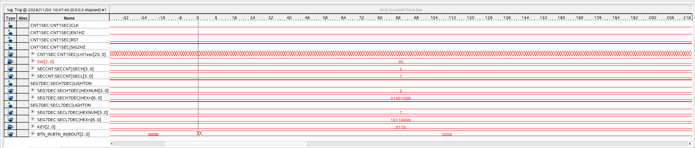

# 開発手順

## 1.seccnt, seg7dec

目視：00->59->00と動作するか？

- btn_in.vの動作を確認した

KEY[2:0]->BTN_IN[2:0]に変換される

## 2.mincnt, hourcnt

11/2 作成段階です

## 3.state(standalone)

SECCLR機能を導入する。

目視：点滅の確認

## 4.clock24

# 各ファイルごとのToDo

## cnt1sec.v

- SIG2HZ の信号が何回かトリガを掛ければ上下反転することを確認する
- SIG2HZ　が SIG0.5HZ に修正する

## seccnt

- output reg SECH,SECL -> output reg SECL,SECHに変更。これに伴って、L->Hの順番にすべて変更。

